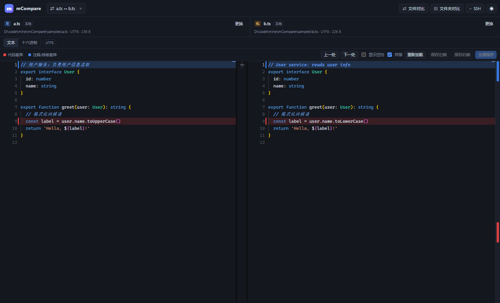
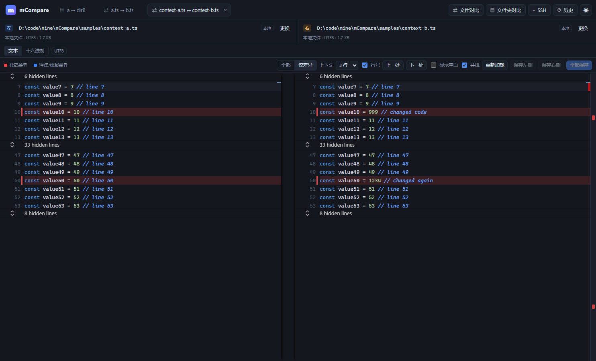
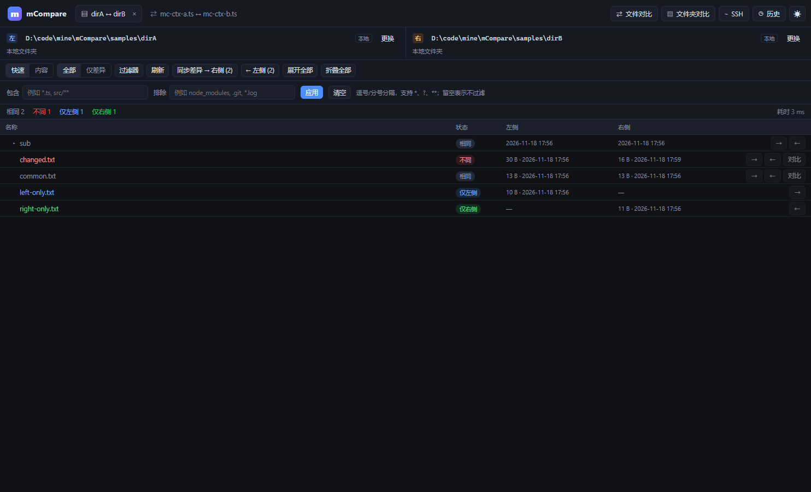
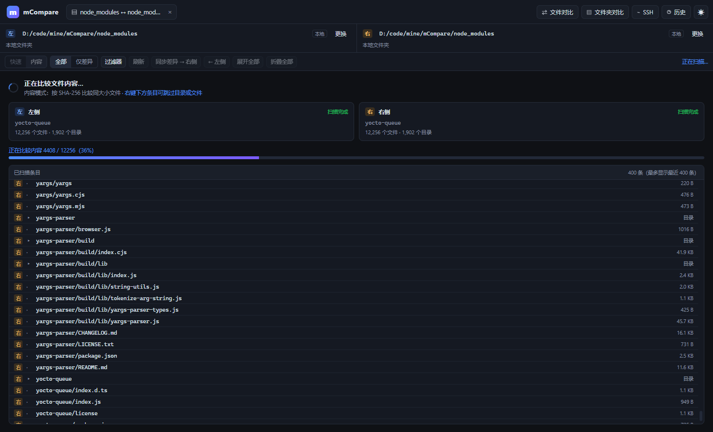
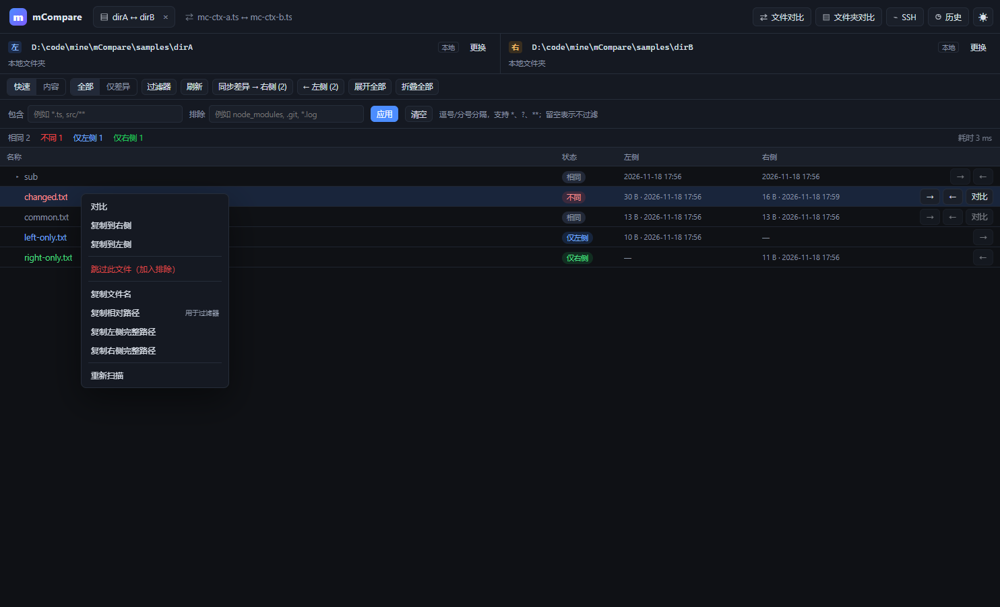
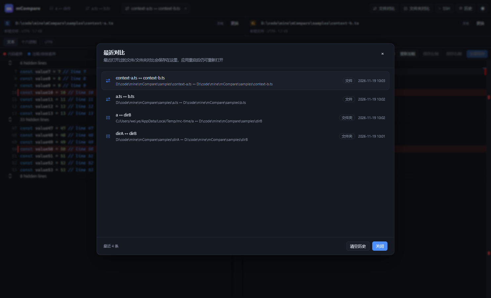

# mCompare

一个 Windows 下 Beyond Compare 风格的轻量对比工具。按“在 Beyond Compare 基础上做减法”的思路实现，聚焦两条主线：

- **代码文件对比**：按文本打开、语法高亮、可编辑保存；差异按 Beyond Compare 的红蓝语义着色。
- **远端 ↔ 远端目录对比**：通过 SSH/SFTP 连接两台服务器（或同一服务器的两个目录），递归比较、双向复制/同步。



## 功能

### 文件对比

- **自动识别**：文本/代码文件用可编辑文本视图打开；二进制文件自动进入十六进制视图，也可手动切换。
- **红蓝两级差异**（对齐 Beyond Compare 的 important / unimportant 差异）：
  - **红色整行**：实际代码内容发生变化。
  - **蓝色整行**：只有注释、缩进、空格等排版变化，代码 token 序列不变。
  - 注释本身按语法高亮显示为蓝色。
- **全部 / 仅差异**：仅差异模式会折叠未修改区域，只保留差异行及其上下文；上下文行数可选 0/1/2/3/5/10。
- 行号可显示/隐藏；在仅差异模式下行号仍保持原文件行号。上下文行数无论调大还是调小都会立即重新计算。
- Monaco 编辑器：双栏并排、行内编辑、查找、撤销重做、同步滚动、差异概览条。
- 上一处 / 下一处差异跳转（`F7` / `Shift+F7`），支持概览条点击定位。
- 文本编辑后 `Ctrl+S` 保存；左右两侧可分别保存或全部保存，保留原文件编码。
- **文件内容双向复制**：工具栏“左 → 右”“右 → 左”可整体复制另一侧内容；目标侧变为未保存状态，保存后写入目标文件，可用撤销恢复。
- 编码自动识别：UTF-8 / UTF-8 BOM / UTF-16 / GB18030(GBK) / Big5 / Shift_JIS 等，保存时写回原编码。
- 文本按行比较一致但字节数/行尾/编码不同时，会提示可能的 CRLF/LF 或编码差异，并可切换十六进制定位。
- 十六进制视图：地址、16 字节十六进制、ASCII 三条信息并排，差异字节标红，支持跳转。
- 可选显示空白字符（空格/制表符以蓝色标记）。
- **路径栏可直接编辑**：本地路径直接输入，或粘贴 `user@host:/home/user/project`、`ssh://user@host:22/home/user/project` 等 SSH 原生路径；自动匹配已保存的连接。



### 文件夹对比

- 递归扫描两个目录，状态分为：相同 / 不同 / 仅左侧 / 仅右侧 / 类型不同。修改时间不参与差异判断。
- 两种比较模式：
  - **快速**：只按文件大小判断（默认，最快）；同大小但内容不同的文件会被视为一致。
  - **内容**：对同大小文件计算 SHA-256，可确认内容是否真正一致；忽略时间戳。
- **实时扫描进度**：首次扫描就会实时构建目录树（文件和目录随扫描出现），扫描和内容比较过程中都可展开/折叠、右键跳过；刷新/切换模式重扫时会保留已有结果树，上方显示紧凑进度条。
- **跳过目录/文件**：在实时条目列表或已有结果树中右键，或点击“当前目录”旁的“跳过目录”按钮，会立即停止扫描该目录并**继续当前扫描**（不会重启整个对比），同时在该对比页中隐藏。跳过项会以路径标签显示在过滤器区域，可逐个移除或清除；跳过只作用于当前对比页。跳过按相对路径**精确匹配其子树**（跳过 `src` 不会误伤 `pkg/src`），与 glob 过滤器的按名称匹配是两套规则。
- **全部 / 仅差异**：仅差异视图隐藏相同项，只保留内容/结构差异；差异目录自动展开。
- **过滤器**：包含/排除两组 glob（`*`、`?`、`**`，逗号或分号分隔）。例如排除 `node_modules, .git, *.log, **/dist/**`。过滤变更会**即时作用于当前结果，不会自动重新触发比较**；点击刷新/开始新扫描时会按当前过滤条件跳过目录。放宽过滤范围后如需恢复未扫描内容，界面会提示手动刷新。
- **扫描告警**：无权限目录、超过 48 层的递归、内容哈希读取失败等不会再被静默忽略；结果页顶部会显示告警数量和具体路径，避免把“没读到”误认为“只存在于另一侧”。哈希失败的条目保守标记为“不同”。
- **复制与同步的写入安全**：本地覆盖写通过同目录临时文件 + 重命名完成，单个文件失败不会留下半个目标文件；本地文件复制会保留源文件权限位。
- 路径栏可直接输入/粘贴本地路径和 SSH 路径，不必每次点“更换”。
- **右键菜单**（目录树和扫描实时列表）：
  - 跳过此目录/文件（当前对比，显示在过滤器区域）
  - 复制文件名
  - 复制相对路径（可直接粘进过滤器）
  - 复制左侧/右侧完整路径
  - 对比、复制到另一侧、重新扫描
- 路径输入框和过滤器输入框支持原生右键菜单（撤销/剪切/复制/粘贴/全选）。
- 目录默认折叠，不再自动展开差异目录；切换“仅差异”时会展开差异目录，也可手动展开全部/折叠全部。重新扫描（刷新/切换模式）时保留你当前的展开状态。
- 双击文件对直接打开文件对比。
- 行内复制按钮：文件/目录可整棵子树复制到另一侧（带确认）。
- **同步全部差异**：一键把差异文件同步到右侧或左侧，带进度和失败统计；只同步缺失和内容不同的文件。
- 本地 ↔ 本地、本地 ↔ 远端、**远端 ↔ 远端** 均可。





### SSH 远端

- 用户名 + 密码登录（按需求实现），支持键盘交互认证。
- 保存常用连接；密码使用 Electron `safeStorage` 加密后保存在本机用户目录。
- **主机指纹校验**：首次连接弹窗确认 SHA256 指纹，之后指纹变化会阻止连接并告警。
- 远端目录浏览、远端文件读取/编辑/保存（保存前二次确认）、远端文件夹与本地或另一远端对比。
- 远端 ↔ 远端复制通过本地临时文件中转。
- 支持直接粘贴 `192.0.2.10:/home/user/repo`、`user@host:/path`、`host:port:/path`、`ssh://user@host/path`，按主机/端口/用户名匹配已保存连接。

### 最近对比历史

- 成功打开过的文件对比/文件夹对比会自动记录，应用重启后仍保留。
- 欢迎页显示最近 6 条；顶栏“历史”可查看全部（最多 40 条），点击即可重新打开，无需再次输入路径。
- 支持一键清空历史；历史只保存在本机 `%APPDATA%\mcompare\recent.json`。

### 集成与交互

- 命令行：`mCompare.exe <左侧> <右侧>`，目录或文件均可。便携版建议传绝对路径。
- 单实例运行：再次启动会把路径交给已运行窗口；配合右键菜单可依次选择两个文件自动组成对比。
- Windows 资源管理器右键 “Compare with mCompare”（文件 + 文件夹），脚本见下文。
- 多标签页、深浅主题、未保存标记、关闭前保存提示。
- **设置记忆**：主题、文本视图（全部/仅差异、上下文行数、行号、空白字符、并排）、文件夹比较模式、全部/仅差异视图、过滤器都会保存在本机，重启后继续生效。跳过项只作用于当前对比页，不作为全局设置保存。
- 快捷键：
  - `Ctrl+O` 新建文件对比
  - `Ctrl+Shift+O` 新建文件夹对比
  - `Ctrl+S` 保存当前文件
  - `Ctrl+W` 关闭标签页
  - `Ctrl+Tab` 切换标签页
  - `F7` / `Shift+F7` 下一处 / 上一处差异
  - `F5` 刷新文件夹对比



## 快速开始

环境：Windows 10/11，Node.js 20+（开发使用 Node 24）。

```bash
npm install
npm run dev
```

如果 Electron 二进制下载失败，可指定镜像：

```bash
ELECTRON_MIRROR=https://npmmirror.com/mirrors/electron/ npm install
# 或单独执行
ELECTRON_MIRROR=https://npmmirror.com/mirrors/electron/ node node_modules/electron/install.js
```

运行测试与类型检查：

```bash
npm test           # Vitest 单元/集成测试
npm run test:watch # 监听模式
npm run typecheck  # 主进程 + 渲染进程 TypeScript 检查
```

测试覆盖：glob 语义、客户端树过滤、文件夹扫描/跳过/内容哈希、路径穿越防护、编码识别与无损写回、原子 JSON 存储、实时树构建、复制工具函数等。

生产方式运行：

```bash
npm run build
npm start
```

打包为单文件便携版：

```bash
npm run dist
# 输出：release/mCompare-0.1.0.exe
```

> `electron-builder` 首次打包可能需要联网下载 Windows 打包工具；网络受限时可配置镜像后重试。
> 当前未配置代码签名，首次运行便携版时 Windows SmartScreen 可能提示“未知发布者”，选择“仍要运行”即可。

## 右键菜单

先打包并拿到 `mCompare.exe`，然后以当前用户身份注册（无需管理员）：

```powershell
powershell -ExecutionPolicy Bypass -File scripts\install-context-menu.ps1 -ExePath "D:\path\to\mCompare.exe"
```

卸载：

```powershell
powershell -ExecutionPolicy Bypass -File scripts\uninstall-context-menu.ps1
```

Explorer 多选文件时，系统会为每个文件分别启动一次命令。mCompare 是单实例应用：第一次启动打开左侧，第二次启动自动补到右侧，因此右键两个文件即可得到完整对比。

## 示例

`samples/` 下提供了可直接试用的素材：

```bash
npm run build
npx electron . samples/a.ts samples/b.ts
npx electron . samples/dirA samples/dirB
```

打包后也可以直接：

```powershell
.\release\mCompare-0.1.0.exe "$PWD\samples\a.ts" "$PWD\samples\b.ts"
```

> 提示：`samples/dirA` 与 `samples/dirB` 中的 `sub/inner.txt` 大小相同，快速模式会视为一致；切换到“内容”模式即可检出差异。

## 项目结构

```
src/
  main/          Electron 主进程：窗口、CLI、IPC、本地/远端文件系统、扫描与复制
    encoding.ts  编码识别与无损写回
    filters.ts   服务端 glob 过滤器
    jsonStore.ts 原子 JSON 持久化 + 损坏文件备份
    local.ts     本地读取/扫描/哈希/原子复制
    pathSafety.ts 相对路径清理与目录包含校验
    recent.ts    最近对比历史持久化
    ssh.ts       SSH 连接管理、SFTP、主机指纹校验、远端扫描
    scan.ts      文件夹对齐、差异状态、扫描告警、复制/同步
    ipc.ts       渲染进程 IPC
  preload/       contextBridge 安全 API
  renderer/src/  React + Monaco 界面
    components/  TextDiff / HexCompare / FolderCompare / FolderToolbar / FolderFilterBar / FolderTree / LiveTree / ScanProgress / ContextMenu / LocationBar / History
    folderTree.ts  结果树展平、同步候选、目录集合
    liveTreeModel.ts 扫描中的实时树模型
    treeFilter.ts 客户端即时过滤（不改动扫描结果）
    settings.ts  界面设置持久化
    monaco.ts    Monaco 主题（注释蓝、红蓝差异装饰）
    styles.css   全部界面样式
  shared/
    types.ts     主进程与渲染进程共享类型
    globs.ts     共享 glob 编译器（主进程与渲染进程行为一致）
    pathUtils.ts 跳过路径规范化与匹配
  **/*.test.ts   Vitest 测试，与源码同目录
scripts/
  install-context-menu.ps1 / uninstall-context-menu.ps1
samples/         演示文件
```

技术栈：Electron 45 + React 19 + TypeScript + Monaco Editor + ssh2。

## 已知限制（按当前减法范围）

- 文本文件上限 32MB；十六进制视图每侧只加载前 4MB（超出会提示）。
- 快速模式只按大小判断，不校验同大小文件的内容；需要精确结果请切换“内容”模式。
- 内容模式会对同大小文件做完整流式哈希；超大文件/超大目录会比较耗时，可先用快速模式或跳过无关目录。哈希读取失败的条目会保守标为“不同”，并在扫描告警中列出。
- 目录递归上限 48 层，超过时会停止并显示告警。
- 未实现三路合并、图片/表格/注册表/MP3/PDF 对比、压缩包内比较、FTP。
- 文件夹对比未实现删除和独立下载按钮；仅保留对比、过滤、复制与双向同步。
- “同步全部差异”只复制文件：空的仅一侧目录不会创建，文件/目录类型冲突（`类型不同`）不会自动处理，确认框会提示冲突数量。
- 远端上传/远端就地保存不是原子的（SFTP 直接写目标）；远端不只是上传失败时目标文件可能不完整。远端→远端复制经本地临时文件中转。
- 远端复制不保留 Unix 权限位/属主，只写文件内容。
- SSH 仅支持密码认证（未做私钥/Agent），远端扫描为串行递归，超大目录会较慢。
- 远端扫描跳过符号链接，避免循环。
- 远端路径按 POSIX 规则拼接；若通过 OpenSSH 连接 Windows 服务器，请使用 `/C:/Users/...` 这类路径。
- 文本编码自动识别，界面暂不提供手动指定/覆盖编码的入口；无 BOM 的少数编码可能识别错误，保存前请确认。
- 命令行同时传入一个文件和一个文件夹时不会自动打开（文件对比与文件夹对比是两种模式）。
- 当前仅针对 Windows 构建。

## 安全说明

- SSH 密码优先使用操作系统提供的安全存储（Windows DPAPI）加密；若系统不支持，会退化为本地 Base64 保存（仅用于保证功能可用）。
- 首次连接采用 TOFU（Trust On First Use）校验主机指纹；保存后指纹变化会拒绝连接。
- 本工具不会删除远端文件，复制/同步属于覆盖写操作，执行前均有确认提示。
